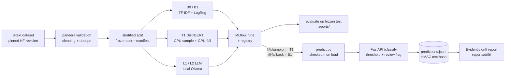

# SupportRouter

Customer-support intent routing with production MLOps. SupportRouter reads a support message,
predicts its **intent** (27 classes, e.g. `cancel_order`, `track_refund`) and **category**
(11 classes, e.g. ORDER, REFUND), and routes the ticket. Predictions below a confidence threshold
are flagged for human review.

The project compares three model families on the same frozen test split: a TF-IDF baseline, a
fine-tuned DistilBERT and a local LLM (zero-shot and few-shot). It then serves the chosen model
with FastAPI, tracks everything in MLflow, ships with Docker Compose, gates every push in CI and
monitors drift with Evidently.


## Architecture



- **One package** (`src/supportrouter`); scripts and the API are thin wrappers around it.
- **Two run modes:** SAMPLE (3,000 training rows, CPU, used by tests and CI) and FULL (same code,
  more data; DistilBERT FULL runs on a GPU).
- **Trust boundaries:** every external input is validated (pandera for data, Pydantic with
  `extra="forbid"` for the API, strict JSON for LLM output); raw customer text is never logged.

## Results

All numbers below are generated from `reports/` by `make readme-results`. A test fails CI if
they are edited by hand or if any number in this README is not in the generated block.

<!-- results:start (generated by `make readme-results` from reports/) -->

**Frozen test split (3,642 messages, 27 intents, 1 seed).** Latency: single message, warm, CPU, predict only.

| Model | Intent macro-F1 | Accuracy | Category macro-F1 | p95 ms | Size MB |
|---|---|---|---|---|---|
| B0 majority class | 0.0029 | 0.0412 | 0.0138 | – | – |
| B1 TF-IDF + LogReg (SAMPLE 3,000) | 0.9822 | 0.9841 | 0.9959 | 0.65 | 1.01 |
| B1 TF-IDF + LogReg (FULL) | 0.9917 | 0.9926 | 0.9973 | 0.76 | 2.53 |
| T1 DistilBERT (SAMPLE 3,000, CPU) | 0.9918 | 0.9929 | 0.9974 | 21.61 | 268.62 |
| T1 DistilBERT (FULL, Colab) — served | 0.9977 | 0.9981 | 0.9993 | 26.47 | 268.62 |

**Seeded 300-message test subset** (same messages for every row; LLM = local `mistral` 7B via Ollama on CPU).

| Model | Intent macro-F1 | Accuracy | p95 ms | Cost / 1k msgs | Invalid outputs |
|---|---|---|---|---|---|
| B1 TF-IDF + LogReg (FULL) | 0.9969 | 0.9967 | 0.63 | – | – |
| T1 DistilBERT (FULL) | 1.0000 | 1.0000 | 21.41 | – | – |
| L1 LLM zero-shot | 0.7801 | 0.7933 | 2,052.67 | $0.00 | 0.0% |
| L2 LLM few-shot | 0.9397 | 0.9400 | 2,558.59 | $0.00 | 0.0% |

**Robustness: seeded synthetic typos on the full test split** (accuracy).

| Typo rate per word | B1 FULL | T1 FULL |
|---|---|---|
| 0.0 | 0.9926 | 0.9981 |
| 0.1 | 0.9775 | 0.9882 |
| 0.2 | 0.9635 | 0.9745 |

**Serving and MLOps.**

| Check | Result | Source |
|---|---|---|
| API `POST /classify`, T1, warm, over HTTP | p50 21.61 ms, p95 27.08 ms (target 250) | `reports/api_latency.json` |
| CI quality gate, B1 SAMPLE on validation | macro-F1 0.9867 vs threshold 0.85 → PASS | `reports/quality_gate.json` |
| Drift report, shifted batch | 4/5 columns drifted → dataset drift True | `reports/drift/summary.json` |
| Drift report, normal batch | 1/5 columns drifted → dataset drift False | `reports/drift/summary.json` |

Hardware: AMD Ryzen 5 5625U with Radeon Graphics, 12 cores.

<!-- results:end -->

### What the numbers say
- **T1 DistilBERT is the most accurate** and the most robust to typos, so it is served
  (`@champion`). It made 7 errors on the test split against 27 for B1
  (`reports/robustness.md`).
- **Negative result:** the project target "T1 ≥ B1 + 2 macro-F1 points" was not met. It could
  not be: B1 FULL already scored 0.9917, so the remaining headroom was smaller than 2 points.
- **B1 is a strong, tiny fallback** (`@fallback`): sub-millisecond and a few MB, but with more
  errors and a larger drop under typos.
- **The local 7B LLM loses to both small models** on this task, and few-shot helps it a lot over
  zero-shot. It never produced an invalid label, but it is orders of magnitude slower on CPU.
- **The dataset is easy and template-like** (near-100% scores). That is why the project adds
  robustness slices, synthetic typos, near-duplicate checks and error analysis instead of
  trusting one headline number.

## Quickstart

Requirements: Linux or macOS, `Python 3.11`, [`uv`](https://docs.astral.sh/uv/), Docker (for
Compose), optionally [Ollama](https://ollama.com) for the LLM rows.

```bash
git clone https://github.com/mohammedImadAlfarra/supportrouter.git
cd supportrouter
make setup                      # uv sync --locked: exact pinned dependencies
make check                      # ruff, mypy strict, pytest + coverage, requirements sync
make data && make split         # pinned dataset -> frozen split, verified against the manifest
make train-sample               # B1 on 3,000 rows (seconds), logged to MLflow
make quality-gate               # the same check CI runs
```

Serving needs registered models (`make train`, a T1 FULL run on a GPU with
`uv run python -m supportrouter.train --model t1`, then `make register`) and a `.env` created from
`.env.example` with a random `PREDICTION_LOG_KEY`:

```bash
make serve                      # http://127.0.0.1:8000/docs
curl -s -X POST http://127.0.0.1:8000/classify \
  -H 'Content-Type: application/json' \
  -d '{"texts": ["I want to cancel the order I placed yesterday"]}'
```

Each result has `intent`, `category`, `confidence` and `needs_human_review` (true when the
confidence is below the threshold chosen on the validation split).

```bash
make compose-up && make compose-smoke   # API :8000 + MLflow server :5000 in Docker
make simulate-traffic && make drift     # with the API running: drift report in reports/drift/
make help                               # every target with a one-line description
```

## MLOps workflow

| Stage | How | Command |
|---|---|---|
| Reproducibility | seed 42 everywhere, pinned dataset and model revisions, `uv.lock`, split hashes | `make split` |
| Tracking | every model is an MLflow run (params, metrics, artifacts, SHA-256 of the model) | `make train` |
| Registry | T1 `@champion`, B1 `@fallback`; the API loads by alias and verifies the checksum | `make register` |
| Evaluation | test split read in one place only, after a hash check; reports are generated, never typed | `make evaluate`, `make compare` |
| Serving | FastAPI, input limits, review threshold, HMAC-hashed prediction log | `make serve` |
| Containers | slim CPU-only image, non-root user, Compose with an MLflow server | `make compose-up` |
| CI | lint, mypy strict, tests with coverage ≥ 70%, gitleaks, quality gate on validation | GitHub Actions |
| Monitoring | seeded traffic simulation, Evidently data and prediction drift | `make drift` |

## Quality rules

Each rule is enforced by tests or CI checks.

- **Reproducibility:** seed 42, pinned dataset and model revisions, identical split hashes.
- **No leakage:** no identical text across splits; transforms are fit on train only.
- **Validated data:** a pandera schema checks every raw file.
- **Frozen test split:** hash-checked on every read and never used for tuning.
- **Honest metrics:** every reported number comes from `reports/` (checked against this README).
- **API input limits:** text length and batch size are bounded; unknown fields are rejected.
- **Safe LLM output:** an answer counts only if it is a known label, otherwise it is invalid.
- **Secrets:** only in `.env`; gitleaks scans the full history in CI.
- **Model integrity:** the model checksum is verified on load.
- **Quality gate:** CI fails if the baseline's validation macro-F1 drops below the threshold.
- **Private logs:** the prediction log stores an HMAC hash of the text, never the text.
- **LLM cost cap:** a run is refused before the first call if its estimate exceeds the cap.

## Repository layout

```text
src/supportrouter/   config, data/ (load, validate, clean, split), models/ (baseline,
                     transformer, llm_adapter, llm_zero_shot), train, evaluate, predict,
                     quality_gate, monitoring/ (traffic, drift_report), readme_results
app/api.py           FastAPI service
scripts/             thin CLI wrappers (download, split, compare, simulate_traffic)
configs/default.yaml every path, seed, threshold and hyperparameter
reports/             generated metrics, comparison, robustness, drift summary
data/processed/      split_manifest.json only (hashes and counts; the data is downloaded)
```

## Limitations

- **Synthetic-style data:** the Bitext dataset is generated from templates, so scores are close
  to 100% and real customer messages will be harder. Results do not transfer without new data.
- **English only**, single-label intents, one seed per model (no variance estimate).
- **The LLM is a local 7B model on CPU**, not a frontier API model; its numbers say nothing about
  hosted LLMs.
- **Drift is simulated:** the shifted batch is built on purpose. On the normal batch the
  `intent` column alone crossed its threshold (sampling noise with 27 classes in 300 messages);
  the dataset-level verdict was still correct. Concept drift is not detectable from the log
  without new labels.
- The Docker image includes training dependencies, so it is larger than a serving-only image.
- MLflow artifact paths are absolute host paths; Compose works for runs created on the same host.

## Data and credits

Dataset: [Bitext customer support LLM chatbot training dataset](https://huggingface.co/datasets/bitext/Bitext-customer-support-llm-chatbot-training-dataset),
license `CDLA-Sharing-1.0`. The data is downloaded at a pinned revision and is **not**
redistributed in this repository. The `response` column is never used as model input.

## License

Code: [MIT](LICENSE). Data: `CDLA-Sharing-1.0` (see above).
